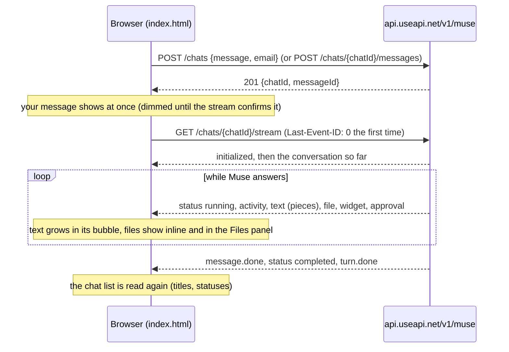
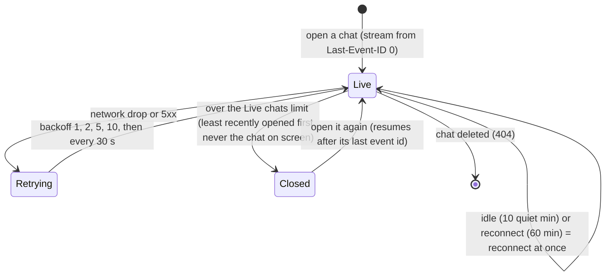
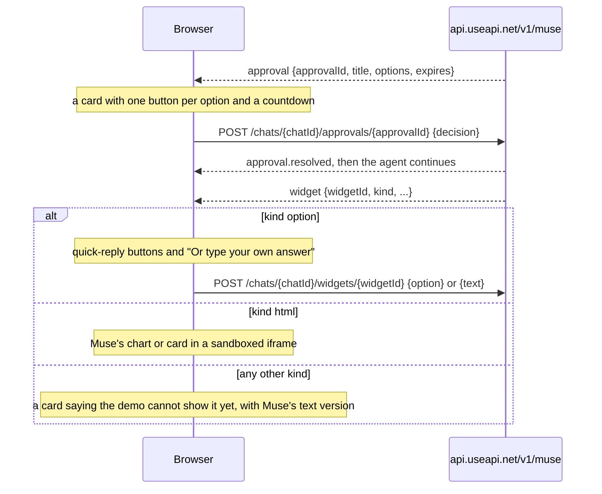

# Meta Muse chat in the browser — Muse API demo app (one HTML file)

▶️ Live: **[useapi.net/demos/muse](https://useapi.net/demos/muse/?utm_source=github.com&utm_medium=referral&utm_campaign=muse-api)** — this exact file, full screen, also on phones

A complete chat client for **Muse (muse.ai)**, Meta's AI agent, built on the [Muse API](https://useapi.net/docs/api-muse-v1?utm_source=github.com&utm_medium=referral&utm_campaign=muse-api) by [useapi.net](https://useapi.net/?utm_source=github.com&utm_medium=referral&utm_campaign=muse-api). It is a single `index.html` of plain HTML, CSS and JavaScript: no framework, no build step, no dependencies. Read it top to bottom to see how each feature maps to one API call.

- **Chat**: your chats on the left, the conversation in the middle, the chat's files on the right (drag the dividers to resize, and on a phone both side panels open as drawers). Muse's answer streams in live, images and videos show inline, quick-reply choices become buttons, Muse's charts and cards (html widgets) render in a sandboxed frame, and when the agent asks for permission a card with its options and a countdown appears in the conversation.
- **Live chats**: the last few chats you opened (5 by default, 1 to 10 with the **Live chats** setting) stay connected in the background, so switching between them is instant and they keep updating. Other chats show their status as of the last list check, greyed with a clock. A chat you come back to resumes exactly where it left off.
- **Account usage**: under the account picker, the share of the weekly Muse allowance used and when it resets, checked from Muse when you pick the account, while an answer runs, shortly after an answer ends, and on **↻**.
- **Files**: two views. **Media** shows every image, video and audio file on the account, filtered by type and origin, with previews, download, delete, copy id, and upload from disk or from a link. **Workspace** browses every file in the account's Muse workspace folder by folder, previews text files (as plain text), images, videos and audio, searches by name and extension, and uploads, downloads or deletes files. Any file can go into your next message.
- **Permissions**: whether the agent asks before acting on websites and connected apps, its standing allow and deny rules, and its permission requests (waiting and answered), each linked to the chat that asked.

## Run it

You need a useapi.net [API token](https://useapi.net/docs/start-here/setup-useapi?utm_source=github.com&utm_medium=referral&utm_campaign=muse-api) and a Muse account (free or paid) added with the [Muse setup](https://useapi.net/docs/start-here/setup-muse?utm_source=github.com&utm_medium=referral&utm_campaign=muse-api).

Open `index.html` in a browser (double-click it), or serve the folder:

```bash
git clone https://github.com/useapi/muse-api.git
cd muse-api
npx serve demo
```

Paste the API token, press **Connect**, pick the account, and write a message.

Your token stays in the browser and is sent only to `api.useapi.net`. It is kept in the page's memory, and in `sessionStorage` (until the tab closes) only when you tick **Remember**.

## Keyboard

- Enter sends, Shift+Enter adds a new line.
- Left and Right arrows move between the Chat, Files and Permissions tabs, and resize the columns when a divider has focus (hold Shift for bigger steps).
- Escape cancels an in-page confirmation, and on a phone closes the chat list or files drawer.

## API calls by feature

Base URL `https://api.useapi.net/v1/muse`, header `Authorization: Bearer <API token>`.

| Feature | API call |
|---|---|
| Account picker | [GET /accounts](https://useapi.net/docs/api-muse-v1/get-muse-accounts?utm_source=github.com&utm_medium=referral&utm_campaign=muse-api) |
| Usage line under the picker | [GET /accounts/{email}](https://useapi.net/docs/api-muse-v1/get-muse-accounts-email?utm_source=github.com&utm_medium=referral&utm_campaign=muse-api) (fresh from Muse, so the demo calls it sparingly) |
| Chat list, Load more | [GET /chats](https://useapi.net/docs/api-muse-v1/get-muse-chats?utm_source=github.com&utm_medium=referral&utm_campaign=muse-api) `?email=&limit=&cursor=` |
| Send the first message of a new chat | [POST /chats](https://useapi.net/docs/api-muse-v1/post-muse-chats?utm_source=github.com&utm_medium=referral&utm_campaign=muse-api) `{message, files, email}` |
| Send a message, also while Muse is answering | [POST /chats/{chatId}/messages](https://useapi.net/docs/api-muse-v1/post-muse-chats-chatId-messages?utm_source=github.com&utm_medium=referral&utm_campaign=muse-api) `{message, files}` |
| The conversation, live | [GET /chats/{chatId}/stream](https://useapi.net/docs/api-muse-v1/get-muse-chats-chatId-stream?utm_source=github.com&utm_medium=referral&utm_campaign=muse-api) with `Last-Event-ID` |
| Title, the chat's files, approvals still waiting | [GET /chats/{chatId}](https://useapi.net/docs/api-muse-v1/get-muse-chats-chatId?utm_source=github.com&utm_medium=referral&utm_campaign=muse-api) |
| Stop | [POST /chats/{chatId}/cancel](https://useapi.net/docs/api-muse-v1/post-muse-chats-chatId-cancel?utm_source=github.com&utm_medium=referral&utm_campaign=muse-api) |
| Delete a chat | [DELETE /chats/{chatId}](https://useapi.net/docs/api-muse-v1/delete-muse-chats-chatId?utm_source=github.com&utm_medium=referral&utm_campaign=muse-api) |
| Quick-reply buttons and "Or type your own answer" | [POST /chats/{chatId}/widgets/{widgetId}](https://useapi.net/docs/api-muse-v1/post-muse-chats-chatId-widgets-widgetId?utm_source=github.com&utm_medium=referral&utm_campaign=muse-api) `{option}` or `{text}` |
| Approval card buttons | [POST /chats/{chatId}/approvals/{approvalId}](https://useapi.net/docs/api-muse-v1/post-muse-chats-chatId-approvals-approvalId?utm_source=github.com&utm_medium=referral&utm_campaign=muse-api) `{decision}` |
| Attach files, Upload files (images, videos, audio) | [POST /assets](https://useapi.net/docs/api-muse-v1/post-muse-assets?utm_source=github.com&utm_medium=referral&utm_campaign=muse-api) `?email=` with the raw file as the body |
| Attach any other file (saved to `workspace/your_files/`, sent as its path) | [POST /files](https://useapi.net/docs/api-muse-v1/post-muse-files?utm_source=github.com&utm_medium=referral&utm_campaign=muse-api) `?email=&path=` |
| Upload URL | [POST /assets](https://useapi.net/docs/api-muse-v1/post-muse-assets?utm_source=github.com&utm_medium=referral&utm_campaign=muse-api) `?email=` with JSON `{url}` |
| Previews and Download | [GET /assets/{assetId}](https://useapi.net/docs/api-muse-v1/get-muse-assets-assetId?utm_source=github.com&utm_medium=referral&utm_campaign=muse-api) |
| Files tab, filters, Load more | [GET /assets](https://useapi.net/docs/api-muse-v1/get-muse-assets?utm_source=github.com&utm_medium=referral&utm_campaign=muse-api) `?email=&type=&origin=&limit=&cursor=` |
| Delete a file | [DELETE /assets/{assetId}](https://useapi.net/docs/api-muse-v1/delete-muse-assets-assetId?utm_source=github.com&utm_medium=referral&utm_campaign=muse-api) |
| Workspace: open a folder | [GET /files](https://useapi.net/docs/api-muse-v1/get-muse-files?utm_source=github.com&utm_medium=referral&utm_campaign=muse-api) `?email=&path=` |
| Workspace: preview and Download | [GET /files/content](https://useapi.net/docs/api-muse-v1/get-muse-files-content?utm_source=github.com&utm_medium=referral&utm_campaign=muse-api) `?email=&path=` |
| Workspace: search | [GET /files/search](https://useapi.net/docs/api-muse-v1/get-muse-files-search?utm_source=github.com&utm_medium=referral&utm_campaign=muse-api) `?email=&name=&extensions=&path=&limit=&offset=` |
| Workspace: Upload here | [POST /files](https://useapi.net/docs/api-muse-v1/post-muse-files?utm_source=github.com&utm_medium=referral&utm_campaign=muse-api) `?email=&path=<folder>/<file name>` (replaces a file of that name) |
| Workspace: Delete | [DELETE /files](https://useapi.net/docs/api-muse-v1/delete-muse-files?utm_source=github.com&utm_medium=referral&utm_campaign=muse-api) `?email=&path=` (files only) |
| Defaults and rules | [GET /accounts/{email}/permissions](https://useapi.net/docs/api-muse-v1/get-muse-accounts-email-permissions?utm_source=github.com&utm_medium=referral&utm_campaign=muse-api) |
| Save defaults | [POST /accounts/{email}/permissions](https://useapi.net/docs/api-muse-v1/post-muse-accounts-email-permissions?utm_source=github.com&utm_medium=referral&utm_campaign=muse-api) `{web, connectors}` |
| A rule's mode | [POST /accounts/{email}/permissions/{permissionId}](https://useapi.net/docs/api-muse-v1/post-muse-accounts-email-permissions-permissionId?utm_source=github.com&utm_medium=referral&utm_campaign=muse-api) `{mode}` |
| Remove a rule | [DELETE /accounts/{email}/permissions/{permissionId}](https://useapi.net/docs/api-muse-v1/delete-muse-accounts-email-permissions-permissionId?utm_source=github.com&utm_medium=referral&utm_campaign=muse-api) |
| Waiting and answered requests | [GET /accounts/{email}/approvals](https://useapi.net/docs/api-muse-v1/get-muse-accounts-email-approvals?utm_source=github.com&utm_medium=referral&utm_campaign=muse-api) |

## How it works

The script in `index.html` is split into numbered sections (config and state, helpers, API client, previews, accounts and usage, chat list, chat state and rendering, streams, sending / widgets / approvals, the other tabs, boot). The [Chat Streaming Guide](https://useapi.net/docs/api-muse-v1/chat-streaming-guide?utm_source=github.com&utm_medium=referral&utm_campaign=muse-api) covers the stream itself in full.

### Sending a message and receiving the answer



- The stream is read with `fetch()`, not `EventSource`, because `EventSource` cannot send the `Authorization` header.
- Every event with an `id` moves the chat's last event id forward. Reconnecting with `Last-Event-ID` sends only the events after it, so nothing is shown twice and nothing is missed.
- One bubble per message id. A file shows once under each answer that shows it, because the stream, `GET /chats/{chatId}` and a resume can all mention the same file. A later answer can show the same asset id again (Muse often rewrites a file in place): it appears there too with fresh bytes, and the Files panel keeps one card per asset id with a refreshed preview.
- Text from the API is always set with `textContent`. Muse's Markdown is turned into DOM nodes by a small renderer, never parsed as HTML.

### Live chats



- Each open stream is a connection kept open for the account, and the API answers `429` past about 50 per account. So the demo keeps only the last few chats you opened live and closes the least recently opened one, preferring chats with no answer running. The chat on screen is never closed.
- Background live chats keep processing their events, so their messages, files and status are current the moment you switch to them.
- A `429` when opening closes another live chat, shows one note and retries once.

### Approvals and widgets



- An html widget runs in an iframe with `sandbox="allow-scripts"` only, so its scripts can draw the chart but cannot read the page, the token or the API. Its colors follow the demo's light or dark theme. A widget that focuses itself as it loads (a game) does not take your keyboard or move the conversation: the demo puts both back. Clicking into it works as usual.
- The account's usage line reads `GET /accounts/{email}`, which asks Muse directly and may sign in again when Muse refused the session. Frequent sign-ins trip Meta's security checks, so the demo checks at most once per 10 minutes when you pick an account, every 5 minutes only while an answer runs and the tab is visible, once about 20 seconds after an answer ends, and on **↻** (automatic checks stay at least 3 minutes apart).

## Good to know

- A message's `files` takes asset ids and workspace paths together. The agent sees them as `image_1`, `video_1`, `audio_1` … and `file_1` ….
- `allow_always` answers are marked **permanent**: they add a standing rule you can later change or remove on the Permissions tab.
- With **Ask for some actions** (`auto_allow`) as a default, Muse may act on your connected apps, for example send an email, without asking.
- A rule set to `ask` is removed, because asking is the default.
- Muse refuses to delete a chat while a turn is running. Stop it first.
- Every file a chat uses must live on the chat's account, so the app uploads to the selected account.

## About useapi.net

[useapi.net](https://useapi.net/?utm_source=github.com&utm_medium=referral&utm_campaign=muse-api) is an experimental REST API for AI services. The Muse API drives your own Muse account for a flat [$15/month](https://useapi.net/docs/subscription?utm_source=github.com&utm_medium=referral&utm_campaign=muse-api), with no per-image or per-video charge. It is an independent, third-party API, not affiliated with or endorsed by Meta.

Visit our [Discord Server](https://discord.gg/w28uK3cnmF) or [Telegram Channel](https://t.me/use_api) for support.
