# n8n workflows for the Muse API

Two ready-to-import [n8n](https://n8n.io) apps built from core n8n nodes, with no community nodes:

- [Old photo to talking video](#old-photo-to-talking-video): [`muse-photo-talks.json`](./muse-photo-talks.json)
- [Create narrated faceless Shorts from any topic with the Meta Muse API](#create-narrated-faceless-shorts-from-any-topic-with-the-meta-muse-api): [`muse-faceless-shorts.json`](./muse-faceless-shorts.json)

## Old photo to talking video

Published on n8n: [Restore and animate old photos into talking videos with Muse and Google Drive](https://n8n.io/workflows/20989)

[`muse-photo-talks.json`](./muse-photo-talks.json) is a ready-to-import [n8n](https://n8n.io) app that restores an old photo and makes the person in it speak a line, with Meta's Muse agent (muse.ai) on your Muse subscription, through the [useapi.net Muse API](https://useapi.net/docs/api-muse-v1?utm_source=github.com&utm_medium=referral&utm_campaign=muse-api), a third-party API, not affiliated with Meta. It is built from core n8n nodes, with no community nodes. Google Sheets and Google Drive are optional.

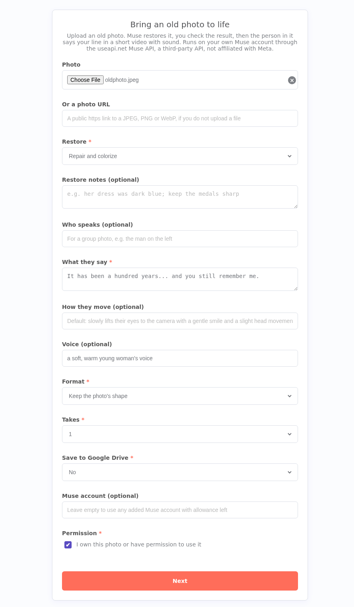

1. **The form.** Upload a photo or paste a link, choose the restore mode (repair and colorize, repair and keep it black and white, or animate it as it is), write the line (up to 30 words: every Muse video is about 10 seconds), and optionally say who speaks in a group photo, how they move and what the voice sounds like. Pick the format and 1 or 2 takes.
2. **Before you spend.** The photo is uploaded to your Muse workspace (uploads are free), and the page shows the account's live weekly allowance with an estimate for this run.
3. **Restored.** Muse restores the photo, keeping the crop and the aspect ratio. Use it, redo it with notes, or animate the original. If Muse refuses, its own words come back here with an edit box.
4. **Your takes.** Muse animates the photo and the person says your line, with sound. 1 or 2 takes run side by side. Pick one, or redo with a new line or motion.
5. **The result.** The page plays the MP4, links the MP4 and the restored WebP, shows the share of the week the run really used (read before and after), lists the asset ids for reuse, and can save both files to Google Drive.

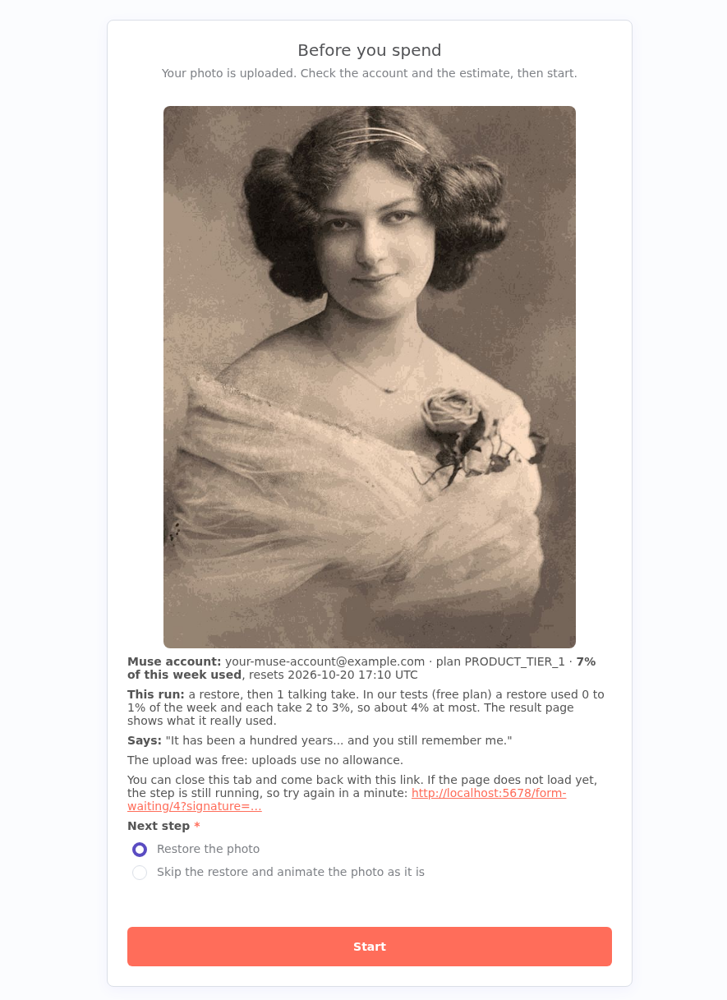

| Restored | Your takes | Result |
|---|---|---|
| 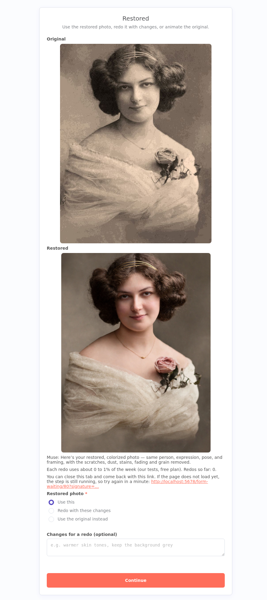 | 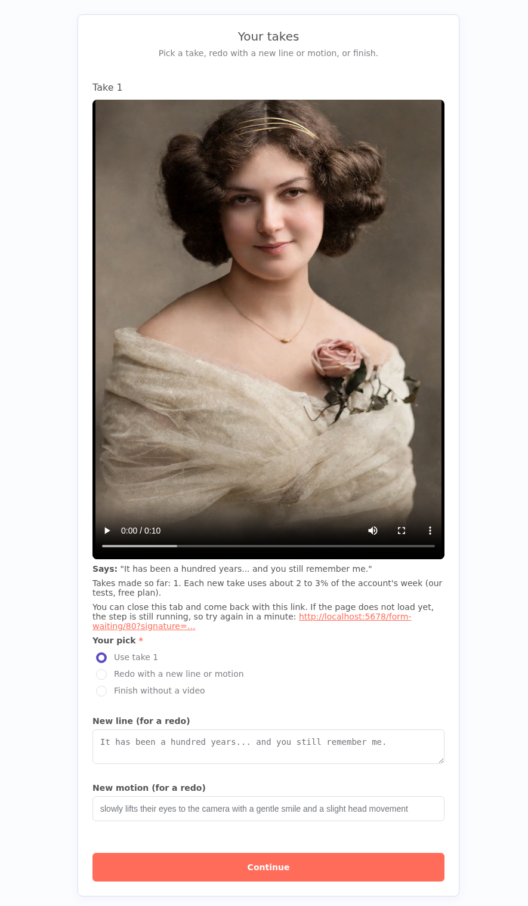 | 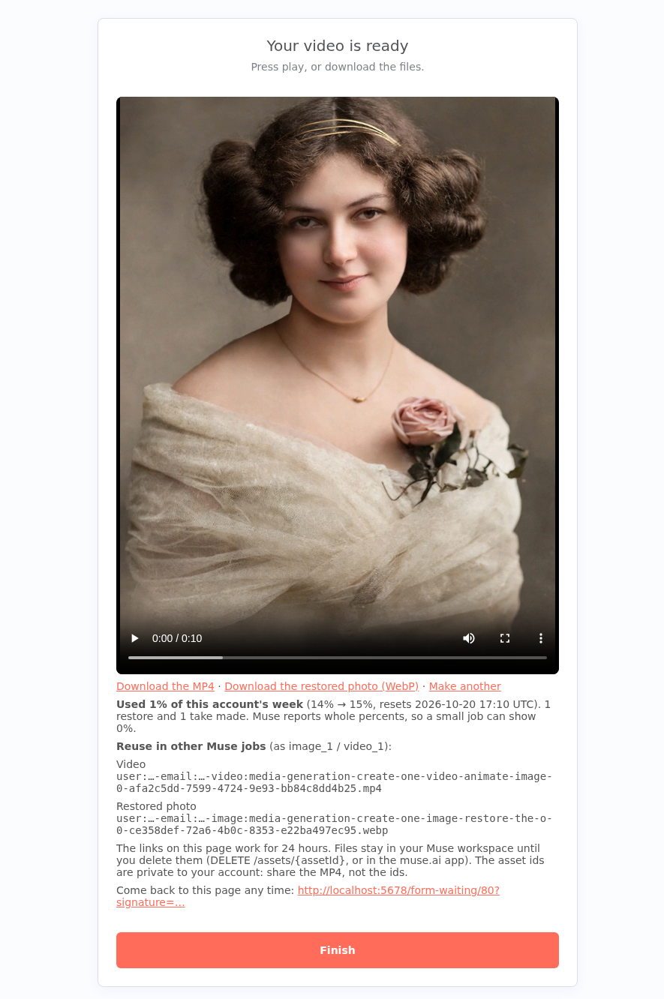 |

Every page carries a resume link, so you can close the tab and come back.

**Errors.** "Nothing was made" answers (`429` busy, `503` Muse could not make it this time) are sent again after 30 seconds, up to 5 and 3 times. A job that may already have used the allowance (`500`, `502`, `504`, or no answer) is never sent again: the page stops with its job id, to check with `GET /jobs/{jobid}?history=true`. Other answers stop with a page that says what to fix: the token (`401`), the account (`404`, `596`), the allowance with its reset time (`412`), or a link that is not an image (`400`).

The token stays in n8n, and the links can't be guessed. Pictures, players and download links go through the workflow's own **Media file** webhook, which fetches each file with your credential. Each link carries a ticket signed with a random secret that the workflow makes once, with the **New secret** node (n8n's Crypto node), and keeps in its static data. A ticket names one file and expires: after 24 hours on the pages, and after `linkHours` (default 7 days) for the links written into the sheet. The webhook never takes an asset id or a URL from the address, and answers 404 to an unknown, edited or expired ticket.

Asset ids are private to your account. The result page lists them so you can reuse the files in other Muse jobs. Anyone who has an asset id and your API token can download that file, so share the MP4, not the ids.

### Google Sheet batch mode (off by default)

One row per photo. Copy the columns from [`old-photos-sheet.csv`](./old-photos-sheet.csv) into a Google Sheet tab named `Old photos`, fill `photo_url`, `restore` (`colorize`, `black and white` or `none`), `line` and optionally `notes`, `who`, `motion`, `voice` and `format` (`9:16`, `16:9`, `1:1`, `4:5`, or empty to keep the photo's shape). Leave `status` empty or `new`.

Every 10 minutes a tick moves each row on:

| `status` | What happens next |
|---|---|
| `new` (or empty) | upload, then restore → `restoring` (with restore `none`: straight to the video → `rendering`) |
| `restoring` | the job is read; when it is done → `check photo`, with a link to the restored photo in `restored_link` |
| `check photo` | waits for you. Type `ok` to animate it, `redo: <notes>` to restore it again with notes, or `original` to animate the original photo |
| `rendering` | the job is read; when it is done → `done`, with the video in `drive_link` (Google Drive, or the media webhook) |
| `error`, `check job` | waits for you: `error` says what to change; `check job` means the job may have used the allowance, so it was not sent again |

The job id is written into the row in the same tick that starts it, so a restart or a late tick reads the job instead of paying twice. At most `maxPerTick` new jobs start per tick (default 3), and no job starts when the account has no allowance left.

To turn it on: set the sheet id and the other options in the **Settings** node, connect a Google Sheets credential to **Read rows** and **Update row** (and Google Drive to **Batch save** if `saveToDrive` is on), then enable the **Every 10 minutes** trigger.

### Setup

1. Get a [useapi.net API token](https://useapi.net/docs/start-here/setup-useapi?utm_source=github.com&utm_medium=referral&utm_campaign=muse-api) and add your Muse account with the [Muse setup](https://useapi.net/docs/start-here/setup-muse?utm_source=github.com&utm_medium=referral&utm_campaign=muse-api).
2. In n8n, import `muse-photo-talks.json`.
3. Create a **Header Auth** credential: Name `Authorization`, Value `Bearer <your API token>`. Select it on every HTTP Request node.
4. Create a **Basic Auth** credential (any username and password) and select it on **Bring a photo to life**. The form asks for this login, so nobody else can open it and spend your allowance.
5. Optional: connect Google Drive to **Upload to Drive** and set the folder at the top of **Read the form**.
6. Publish (activate) the workflow, open the form URL and sign in with that username and password.

**Requirements:** a useapi.net subscription and a Muse account created in the US or Canada (as of October 2026). The free Muse plan works: in our tests a restore used 0 to 1% of the week and each take 2 to 3%.

**Customize:** the restore and talk prompts, the default motion and the Drive folder are at the top of **Read the form**; the batch options and the same prompts are in **Settings**. The aspect ratio is part of the prompt (`in exactly 9:16 aspect ratio`), and the line in quotes is the one that is spoken. Muse follows the requested shape most of the time, but it can keep the photo's own shape; the takes page shows what you got before you keep it.

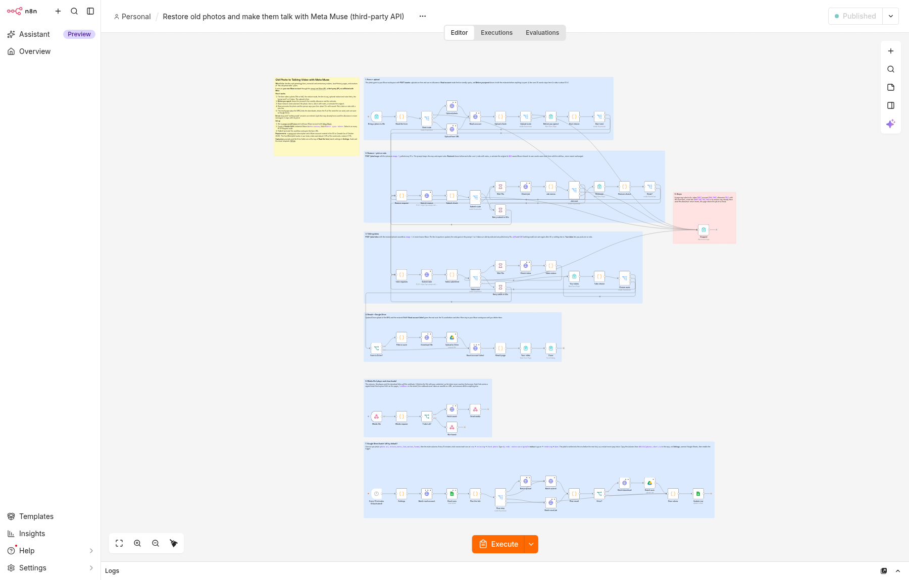

Every endpoint is documented in the [Muse API reference](https://useapi.net/docs/api-muse-v1?utm_source=github.com&utm_medium=referral&utm_campaign=muse-api).

## Create narrated faceless Shorts from any topic with the Meta Muse API

Published on n8n: [Create narrated faceless Shorts from any topic with the Meta Muse API and Google Drive](https://n8n.io/workflows/21207)

[`muse-faceless-shorts.json`](./muse-faceless-shorts.json) is a ready-to-import n8n app that turns a topic into a narrated vertical Short of one to three 10-second scenes, with Meta's Muse agent (muse.ai) on your Muse subscription, through the [useapi.net Muse API](https://useapi.net/docs/api-muse-v1?utm_source=github.com&utm_medium=referral&utm_campaign=muse-api), a third-party API, not affiliated with Meta. Muse writes the script, makes the clips with narration and joins them into one MP4. Google Drive is optional.

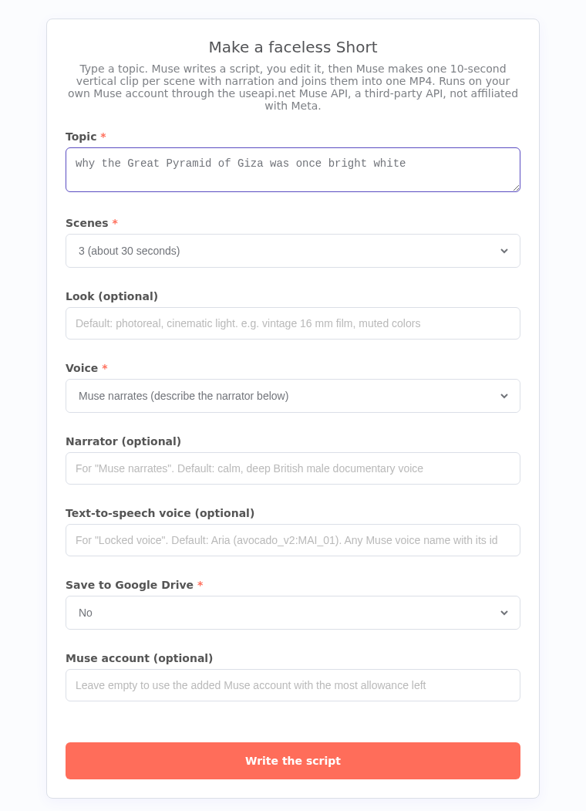

1. **The form.** Type a topic, pick 1, 2 or 3 scenes (about 10 seconds each), optionally describe the look, and choose the voice: **Muse narrates** (describe the narrator, by default a calm, deep British male documentary voice), or **Locked voice** (Muse text to speech reads every line in one voice, by default Aria).
2. **Your script.** A Muse chat writes one spoken line and one shot per scene, as JSON. The page shows the account's live weekly allowance and an estimate. Edit any line or shot, or ask for a new script with notes.
3. **Your scenes.** Muse makes one vertical 9:16 clip per scene, side by side, and speaks each line word for word. With the locked voice, Muse lays its own text-to-speech file onto each clip, so every scene has the same voice. Redo any scene with a new line or shot.
4. **The result.** A Muse chat joins the clips into one MP4. The page plays it, links the MP4 and each scene, shows the share of the week the run really used (read before and after) and the title and script for the description, and can save the MP4 to Google Drive.

| Your script | Your scenes | Result |
|---|---|---|
| 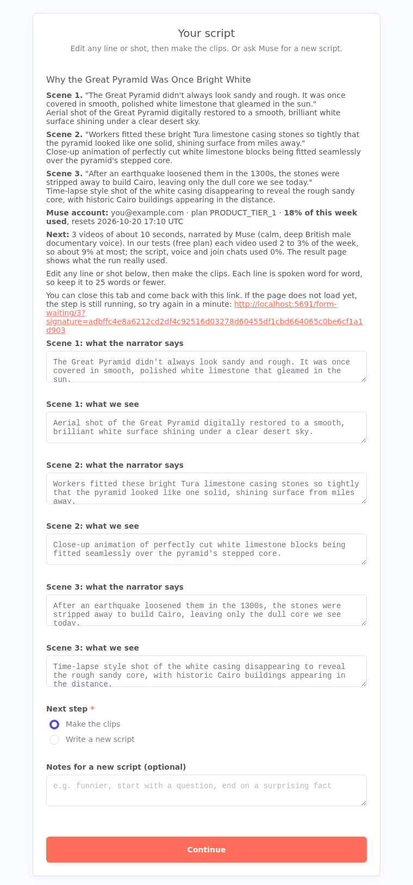 | 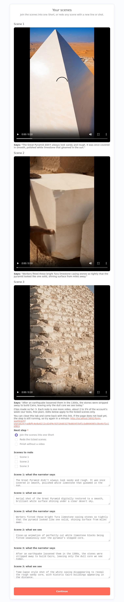 | 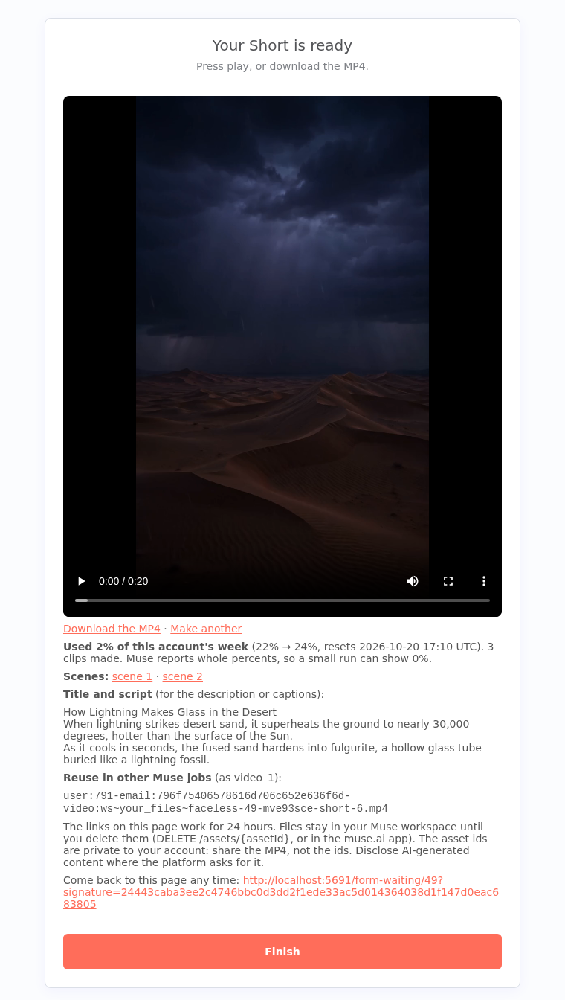 |

Every page carries a resume link, so you can close the tab and come back.

**Errors.** "Nothing was made" answers (`429` busy, `503` Muse could not make it this time) are sent again after 30 seconds, up to 5 and 3 times. A video job that may already have used the allowance (`500`, `502`, `504`, or no answer) is never sent again: the page shows its job id, to check with `GET /jobs/{jobid}?history=true`. A script that can't be read as JSON gets one new chat. Muse's permission requests are denied: none of these chats needs the web or a public link.

The token stays in n8n, and the links can't be guessed. Players and download links go through the workflow's own **Media file** webhook, which fetches each file with your credential. Each link carries a ticket that names one file, expires after 24 hours, and is signed with a random secret made once by the **New secret** node (n8n's Crypto node) and kept in the workflow's static data. The webhook never takes an asset id or a URL from the address, and answers 404 to anything else.

**Files.** Every run makes chats and files in your Muse workspace (they also show in the muse.ai app) under names unique to the run. With the locked voice, each finished clip is copied at once with a free upload, so a later clip saved under the same name can't replace it.

### Setup

1. Get a [useapi.net API token](https://useapi.net/docs/start-here/setup-useapi?utm_source=github.com&utm_medium=referral&utm_campaign=muse-api) and add your Muse account with the [Muse setup](https://useapi.net/docs/start-here/setup-muse?utm_source=github.com&utm_medium=referral&utm_campaign=muse-api).
2. In n8n, import `muse-faceless-shorts.json`.
3. Create a **Header Auth** credential: Name `Authorization`, Value `Bearer <your API token>`. Select it on every HTTP Request node.
4. Create a **Basic Auth** credential (any username and password) and select it on **Make a faceless Short**, so nobody else can open the form and spend your allowance.
5. Optional: connect Google Drive to **Upload to Drive** and set the folder at the top of **Read the form**.
6. Publish (activate) the workflow, open the form URL and sign in with that username and password.

**Requirements:** a useapi.net subscription and a Muse account created in the US or Canada (as of October 2026). The free Muse plan works: in our tests each 10-second video used 2 to 3% of the week on the free plan, and the script, voice and join chats used 0%.

**Customize:** the prompts (script, narrated clip, voiced clip, text to speech, join), the default look, narrator and voice, and the Drive folder are at the top of **Read the form**. Any of Muse's text-to-speech voices works in the form: its name with its id, for example `Discreet Key (avocado_v2:vd2_r82_rep5k_2434_v068_28k_g5k)`, a calm British male voice.

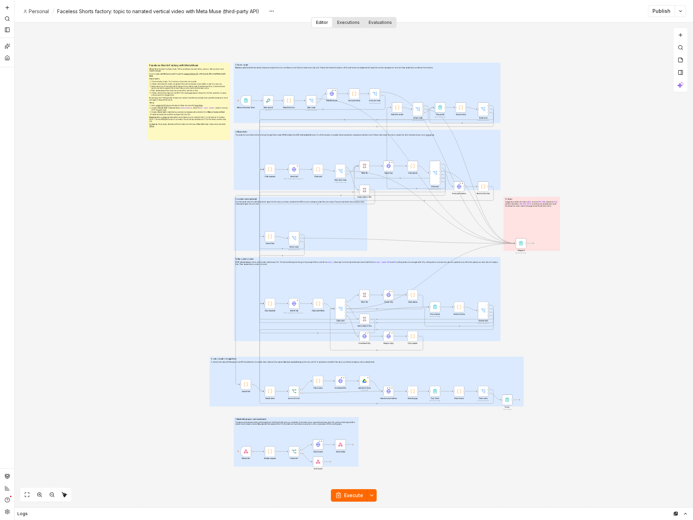
